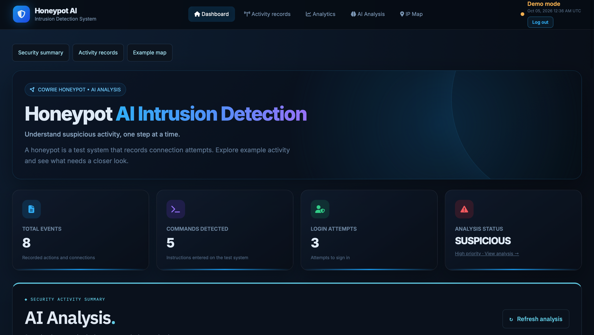

<div align="center">

# 🛡️ HONEYPOT AI INTRUSION DETECTION

### Intelligent Honeypot Monitoring & Security Analysis

**A cybersecurity monitoring system powered by Cowrie, Flask and machine learning.**


**Team 4 | Georgia Gwinnett College**

[Project Overview](#-project-overview) •
[Features](#-key-features) •
[Installation](#-installation) •
[AI Analysis](#-ai-analysis) •
[Testing](#-testing)

</div>

---

# 📖 Project Overview

Honeypot AI Intrusion Detection is an educational cybersecurity project designed to collect, analyze and visualize honeypot activity.

The system uses the Cowrie SSH honeypot to record simulated attacker interactions. Python processes the collected events, while a Flask-based dashboard presents the information through charts, maps and security analysis.

The project also includes a Random Forest machine-learning demonstration and evidence-based detection.

### Project Objectives

- Monitor honeypot activity.
- Analyze login attempts and recorded commands.
- Visualize security events and source IP information.
- Identify potentially suspicious behavior.
- Provide an accessible security monitoring dashboard.
- Support controlled cybersecurity testing and analysis.

> **Current demonstration:** The hosted dashboard uses sample Cowrie data. Map locations are preset examples, and the machine-learning model has not been validated on real attack traffic.

---

# ✨ Key Features

| Feature | Description |
|---|---|
| 🐝 Cowrie Honeypot | Records simulated SSH interactions |
| 📊 Security Dashboard | Displays event summaries and security activity |
| 🗺️ Geographic Map | Visualizes preset source IP locations |
| 📈 Activity Charts | Presents event information graphically |
| 🔐 Login Monitoring | Displays successful and failed login activity |
| 💻 Command Monitoring | Examines commands recorded by Cowrie |
| 🤖 AI Analysis | Uses a Random Forest demonstration model |
| 🔎 Activity Filtering | Filters records by event type and connection address |
| 🛡️ Security Evidence | Identifies selected suspicious activity indicators |
| 🌐 Web Deployment | Makes the dashboard accessible through Render |

---

# 🖥️ Dashboard Overview

Our Flask dashboard transforms raw Cowrie events into organized security information.

### Dashboard Components

- Security activity summary cards
- Event distribution charts
- Geographic source IP map
- Source IP information
- Login activity
- Recorded commands
- Recent activity
- AI Analysis
- Activity filtering and pagination

### Dashboard Design

The interface uses a modern cybersecurity-inspired design with a dark theme, security status indicators, responsive layouts and interactive visualizations.

Dashboard components are developed using Python, Flask, HTML, CSS and JavaScript.

### 🌐 Live Dashboard

You can access our hosted dashboard here:

**[Open Our Honeypot AI Dashboard](https://honeypot-ai-intrusion-detection.onrender.com/#analytics)**

The hosted dashboard currently uses demonstration data.

### 📸 Dashboard Overview



*Our dashboard provides security summary cards, AI analysis, activity navigation, and monitoring information.*
---
# 🏗️ System Architecture

The project uses several components to support honeypot monitoring and analysis.

```text
             +----------------------+
             |    Cowrie Honeypot   |
             |  SSH Event Capture   |
             +----------+-----------+
                        |
                        v
             +----------------------+
             |   Cowrie JSON Logs   |
             +----------+-----------+
                        |
             +----------+-----------+
             |                      |
             v                      v
    +----------------+    +-------------------+
    | Event Storage  |    | Python Analysis   |
    | MariaDB Import |    | Evidence + Model  |
    +----------------+    +---------+---------+
                                   |
                                   v
                         +--------------------+
                         |  Flask Dashboard   |
                         +---------+----------+
                                   |
                                   v
                         +--------------------+
                         | Security Insights  |
                         | Charts, Maps, Logs |
                         +--------------------+
```

**Architecture note:** The repository includes a MariaDB event importer, but the current dashboard demonstration reads `sample_data/cowrie.json`. The database is not currently the dashboard's live data source.

---

# 🛠️ Technology Stack

| Technology | Purpose |
|---|---|
| Python | Backend development and event analysis |
| Flask | Web application framework |
| Cowrie | SSH honeypot |
| Docker | Containerized honeypot environment |
| Colima | Docker runtime environment on macOS |
| Scikit-learn | Random Forest demonstration model |
| MariaDB | Event storage and import |
| HTML | Dashboard structure |
| CSS | Dashboard appearance and responsive design |
| JavaScript | Dashboard interactions and visualizations |
| Git | Version control |
| GitHub | Source code management and collaboration |
| Render | Web application hosting |
| VS Code | Development environment |

---

# 📁 Project Structure

```text
honeypot-ai-intrusion-detection/
│
├── ai/
│   └── analyzer.py
│
├── dashboard/
│   └── dashboard.py
│
├── database/
│   └── import_cowrie.py
│
├── sample_data/
│   └── cowrie.json
│
├── tests/
│
├── auth_security.py
├── requirements.txt
├── .gitignore
└── README.md
```

### Folder Descriptions

**ai/**

Contains the Python security analysis implementation.

**dashboard/**

Contains the Flask dashboard application and its interface.

**database/**

Contains the Cowrie event import implementation for MariaDB.

**sample_data/**

Contains sample Cowrie events used for demonstration and testing.

**tests/**

Contains automated tests for analysis, authentication and dashboard behavior.

---

# 🚀 Installation

Follow these instructions to run the dashboard locally.

## Step 1: Clone the Repository

```bash
git clone https://github.com/akhialam-beep/honeypot-ai-intrusion-detection.git
```

Navigate to the project folder:

```bash
cd honeypot-ai-intrusion-detection
```

**Note:** This repository is currently private. Your instructor or teammates will need repository access to clone it.

## Step 2: Create a Virtual Environment

Use Python 3.12 with OpenSSL/scrypt support.

Apple's bundled Python 3.9 may not support the password hashing required by the login page.

```bash
python3.12 -m venv venv
```

Activate the environment:

```bash
source venv/bin/activate
```

## Step 3: Install Dependencies

```bash
python -m pip install -r requirements.txt
```

## Step 4: Start the Dashboard

```bash
python -m flask --app dashboard/dashboard.py run \
  --host 127.0.0.1 \
  --port 5050 \
  --no-debugger \
  --no-reload
```

## Step 5: Open the Dashboard

Open the following address in your browser:

http://127.0.0.1:5050

Keep the Flask server running.

### Demonstration Login

| Field | Value |
|---|---|
| Username | `demo` |
| Password | `StickyDemo2026!` |

These are the current bundled demonstration credentials.

Environment variables can override them:

- `DEMO_USERNAME`
- `DEMO_PASSWORD`
- `SECRET_KEY`

For hosted use, configure your own credentials and secret key. Use a production WSGI server rather than Flask's development server.

**Security note:** These are shared demonstration credentials. Do not use them to protect private activity or sensitive information.

---

# 🤖 AI Analysis

The dashboard includes an AI Analysis section.

Select **AI Analysis** from the dashboard navigation or **View analysis** from the overview.

### Available Analysis Features

- Overall security assessment
- Expandable security evidence
- Source-specific priorities
- Recommended next steps
- Demonstration machine-learning signal
- Refreshable analysis
- Activity filtering
- Paginated activity records

### Random Forest Model

The project uses Scikit-learn's Random Forest classifier.

The current model uses two features:

1. Command count
2. Login count

It is trained using eight synthetic training examples and fitted once per server process.

The model provides a suspicious-class signal to support the demonstration.

### Important Model Limitations

The displayed model signal is not:

- Validated accuracy
- A calibrated attack probability
- Proof of a successful attack
- Proof of system compromise

The model has not undergone held-out evaluation using real attack traffic.

Evidence-based detection operates separately from the model.

A model signal above 50% can raise the overall status to **Review**. High-priority evidence can produce a **Suspicious** status.

A low model signal does not guarantee that activity is safe.

---

# 🔍 Security Evidence Detection

The analysis checks selected patterns in the recorded honeypot events.

### 1. Download Attempts

Identifies basic `wget` or `curl` commands with HTTP, HTTPS or FTP destinations.

### 2. Account-File Commands

Identifies selected file-reading commands targeting:

- `/etc/passwd`
- `/etc/shadow`

### 3. Repeated Login Failures

Identifies at least three failed logins from the same known source within the loaded log.

This does not establish an attack rate or prove a brute-force attack.

### 4. Accepted Honeypot Logins

Highlights accepted logins to the decoy environment.

An accepted honeypot login does not mean a production system was compromised.

### 5. Discovery Commands

Identifies selected identity, system and directory inspection commands.

These commands can also be part of legitimate system administration.

### Detection Limitations

The evidence checks use limited heuristics rather than a complete shell interpreter.

Recorded commands are not executed, external destinations are not fetched, and the analysis does not automatically block sources or modify firewall rules.

Evidence previews display up to three matching events per finding and 400 characters per command.

The source table displays up to ten source groups.

---

# 📊 Activity Records

The dashboard provides activity filtering and detailed event inspection.

Users can:

- Filter records by event type.
- Filter records by connection address.
- View recent activity.
- Inspect login and command information.
- Refresh the analysis.
- Browse paginated activity records.

The **View all records** section displays 25 records per page.

Filters affect the displayed activity list, not the full-log security analysis.

Automatic refresh pauses while evidence is expanded or a form control is focused.

---

# 🗂️ Data Sources

The current dashboard demonstration reads:

```text
sample_data/cowrie.json
```

The input is selected using `LOG_FILE` in:

```text
dashboard/dashboard.py
```

Each nonempty JSON line must contain an object with a string `eventid`.

Optional fields include:

- `src_ip`
- `timestamp`
- `input`
- `username`
- `session`

These optional fields must contain strings or null values.

Invalid records are skipped and counted.

The dashboard also handles missing files, empty datasets and limited-data conditions.

**Important:** Sample data and preset map locations are labeled as demonstration information rather than verified live attack activity.

---

# 🧪 Testing

The project includes automated tests for the dashboard, authentication and analysis.

### Run Automated Tests

```bash
venv/bin/python -m unittest discover -s tests -v
```

### Check Dependencies

```bash
venv/bin/python -m pip check
```

### Run the AI Analyzer

```bash
venv/bin/python ai/analyzer.py
```

### Analyze Another Cowrie Log

```bash
venv/bin/python ai/analyzer.py /path/to/cowrie.json
```

### Test Coverage

The repository includes tests covering:

- Source attribution
- Sample security findings
- Model evaluation
- Benign command text
- Quoted delimiters
- Malformed records
- Extreme timestamps
- Authentication
- Empty-data states
- Refresh submissions
- HTML and script escaping

The analysis module can also be reused by future data sources.

---

# 🔐 Authentication & Security

The application includes authentication and session protections.

### Hosted Session Protection

Render sessions use:

- HTTPS-only cookies
- HttpOnly cookies
- SameSite=Lax cookies
- Eight-hour session lifetime
- CSRF checks on sign-in and sign-out
- No-store responses
- POST-based sign-out

Local HTTP remains supported for development.

### Login Attempt Protection

The application allows ten login attempts per minute for the configured account.

A separate shared bucket handles unknown usernames.

SQLite reservations provide atomic updates across workers on one server instance.

A successful login clears the configured account's failed-attempt counter.

The local limiter resets when a new Render instance is deployed or started. Additional shared or edge-level rate limiting would be needed before scaling to multiple instances.

### Hosted Configuration

Configure the following environment variables in Render:

```text
DEMO_USERNAME
DEMO_PASSWORD
SECRET_KEY
```

Alternatively, a Werkzeug password hash can be configured using:

```text
DEMO_PASSWORD_HASH
```

A password hash takes precedence over the plain password.

A stable random `SECRET_KEY` is required for reliable sessions across multiple workers.

Never commit private production credentials.

### Login Throttle Storage

The default throttle database is:

```text
instance/login-attempts.sqlite3
```

It contains login bucket counters and timestamps.

The file is excluded from Git.

Its location can be changed using:

```text
LOGIN_THROTTLE_DB
```

---

# 🌐 Deployment

The Flask dashboard is hosted using Render.

GitHub is used for source code management and team collaboration.

### Deployment Workflow

```text
VS Code
   |
   v
Git Commit
   |
   v
GitHub Repository
   |
   v
Render Auto-Deploy
   |
   v
Hosted Dashboard
```

Render is configured to automatically deploy updates from the connected GitHub branch.

### GitHub Repository

https://github.com/akhialam-beep/honeypot-ai-intrusion-detection

### Live Dashboard

Add the verified Render service URL here.

The hosted dashboard currently uses demonstration data.

---

# 👥 Project Team

**Georgia Gwinnett College — Team 4**

| Team Member | Project |
|---|---|
| Akhi Alam | Honeypot AI Intrusion Detection |
| Keyauna Fuller | Honeypot AI Intrusion Detection |
| Binta | Honeypot AI Intrusion Detection |

Project development includes honeypot configuration, dashboard implementation, security analysis, testing, documentation and deployment.

---

# 📌 Project Status

| Component | Status |
|---|---|
| Cowrie Honeypot Setup | Completed locally |
| Flask Dashboard | Implemented |
| Dashboard Visualizations | Implemented |
| Geographic Map | Demonstration locations |
| Activity Filtering | Implemented |
| Random Forest Analysis | Demonstration model |
| Automated Tests | Included |
| GitHub Repository | Active |
| Render Deployment | Configured |
| Live Cowrie Integration | Future improvement |
| Real-Traffic Model Evaluation | Future improvement |

---

# 🛡️ Security Disclaimer

This project is developed for educational cybersecurity research and controlled testing.

Cowrie should be operated in an appropriately isolated environment.

The dashboard analyzes recorded honeypot events. It does not execute recorded attacker commands, retrieve the destinations mentioned in those commands or automatically block network sources.

Demonstration findings should not be interpreted as validated detection performance.

---

# 📚 References

- [Cowrie Honeypot](https://github.com/cowrie/cowrie)
- [Flask Documentation](https://flask.palletsprojects.com/)
- [Scikit-learn RandomForestClassifier](https://scikit-learn.org/1.6/modules/generated/sklearn.ensemble.RandomForestClassifier.html)
- [Render Documentation](https://render.com/docs)
- [GitHub Documentation](https://docs.github.com/)

---

<div align="center">

### 🛡️ Honeypot AI Intrusion Detection

**Georgia Gwinnett College | Team 4**

*Cybersecurity Monitoring • Honeypot Analysis • Machine Learning*

</div>
